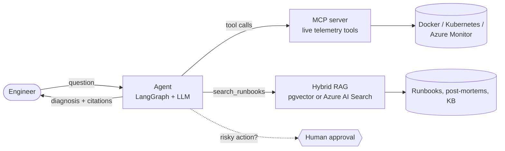
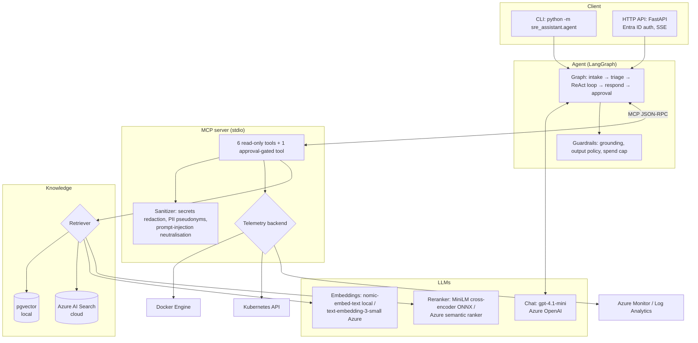
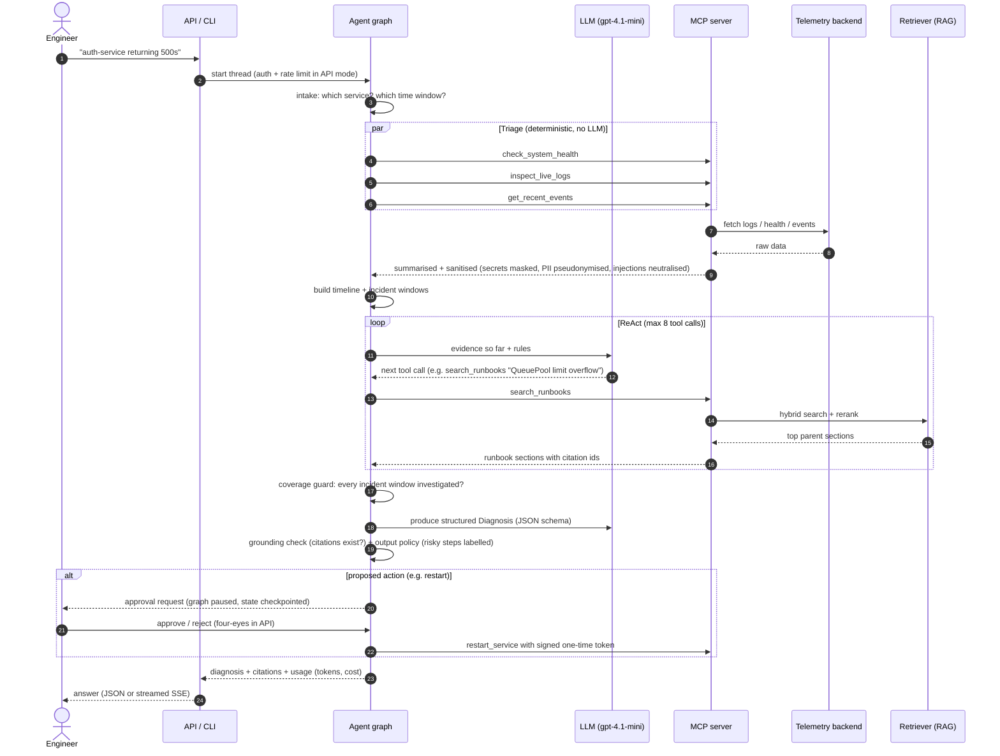
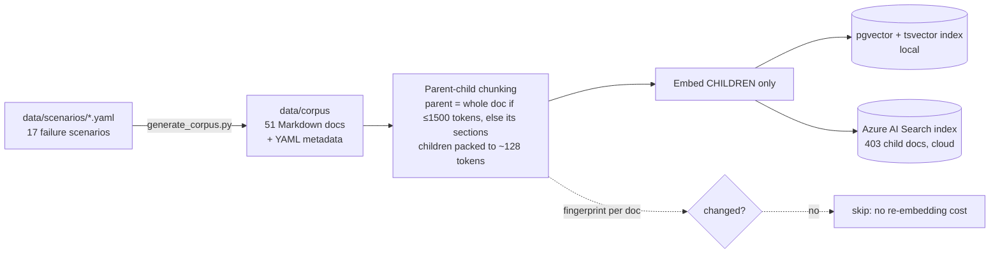
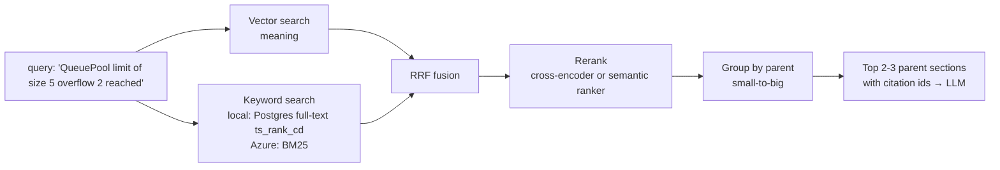
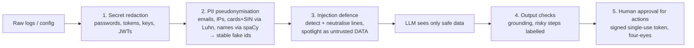
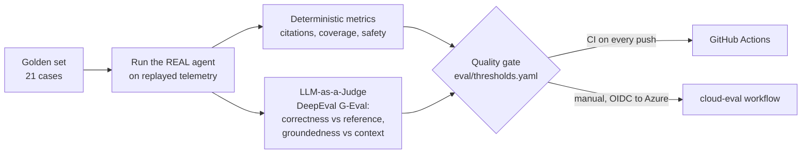
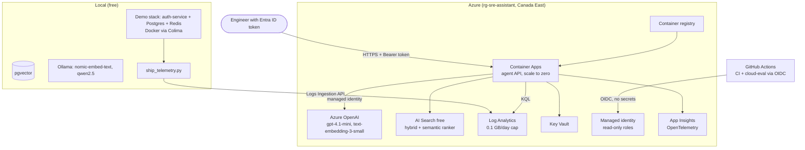

# Architecture Guide: how the SRE Assistant works, what it uses, and why

This is the "one document" overview of the project. For deeper explanations, interview Q&A and quizzes, each section links to
the phase notes in [learning/](learning/README.md).

---

## 1. What the project does (in one minute)

You tell the assistant: *"auth-service in staging is returning 500 errors. Diagnose it."*

It then works like an experienced on-call engineer:

1. **Looks at the live system**: logs, health, restarts, recent events (through an **MCP server**).
2. **Finds the key error**: e.g. `sqlalchemy.exc.TimeoutError: QueuePool limit of size 5 overflow 2 reached`.
3. **Searches the team's knowledge**: runbooks, past post-mortems, Q&A (through **hybrid RAG**).
4. **Answers with evidence and sources**: root cause, immediate mitigation, permanent fix, citations like `[RB-AUTH-DB-POOL] Root Cause`.
5. **Never acts on its own**: risky actions (restart) need a **human approval**, and secrets/PII never reach the LLM.



---

## 2. The big picture (all components)



**Key design idea: "ports and adapters".** The agent never talks to Docker, Kubernetes, Postgres or Azure directly.
It only knows two interfaces:

| Interface | Implementations | Switch |
|---|---|---|
| `TelemetryBackend` (where live data comes from) | `DockerBackend`, `AzureMonitorBackend`, `KubernetesBackend`, `ReplayBackend` (evals) | `SRE_TELEMETRY_BACKEND` |
| Retriever `retrieve(query, filters)` (where knowledge comes from) | `HybridRetriever` (pgvector), `AzureSearchRetriever` | `SRE_RETRIEVER_BACKEND` |
| Chat / embedding provider | Ollama (local), Azure OpenAI | `SRE_CHAT_PROVIDER`, `SRE_EMBEDDING_PROVIDER` |

Moving from laptop to cloud was therefore a **config change**, not a rewrite.

---

## 3. End-to-end flow of one diagnosis



What each step is for:

| Step | Why it exists |
|---|---|
| **Intake** | Extracts service and time window so tools get precise arguments. |
| **Deterministic triage** | Health, logs and events are *always* needed; fetching them in parallel without the LLM is faster and cheaper than letting the model "decide". |
| **Incident windows** | Groups errors by time; if two unrelated incidents overlap, the agent must investigate both and not invent a causal link. |
| **ReAct loop** | The LLM decides what else to check (runbook search, config) based on evidence. Bounded to 8 tool calls. |
| **Coverage guard** | Code (not the LLM) checks every significant incident was searched for; if not, it reminds the model. |
| **Structured output** | The answer is a validated JSON object (`Diagnosis`), so the code can check it. |
| **Grounding + policy** | Removes citations whose document wasn't retrieved in this thread (doesn't prove each claim is entailed); labels dangerous recommendations "requires approval". |
| **Approval** | LangGraph `interrupt()` pauses the run; only a human can resume it. The restart tool requires an HMAC-signed, single-use token the LLM never sees. |

Deeper: [04-agent.md](learning/04-agent.md), [05-guardrails.md](learning/05-guardrails.md).

---

## 4. Models: which, where, why

| Model | Role | Runs where | Why this one | Cost |
|---|---|---|---|---|
| **gpt-4.1-mini** (Azure OpenAI) | The agent's brain: tool selection, diagnosis, also the eval **judge** | Azure, keyless (Entra ID) | Strong tool calling + structured JSON output, fast, cheap. Local 7B was too slow on a laptop (3.6 tokens/s) | $0.40 / 1M input, $1.60 / 1M output → ≈ **$0.008 per diagnosis** |
| **qwen2.5:7b** (Ollama) | Local chat option (Phase 0-3 development) | Laptop | Free, private, good tool calling for its size | $0 (but slow on CPU) |
| **nomic-embed-text** (Ollama, 768-d) | Embeddings for the **local** pgvector index | Laptop | Free, good quality, 8k context; requires `search_query:` / `search_document:` prefixes | $0 |
| **text-embedding-3-small** (Azure, 1536-d) | Embeddings for the **Azure AI Search** index | Azure | Excellent on technical text (stack traces, config); cheap; hybrid alone reached 1.00 hit@1 | $0.02 / 1M tokens (full index ≈ $0.002) |
| **ms-marco-MiniLM-L-6-v2** cross-encoder (ONNX via fastembed) | **Reranker**: re-scores the top ~30 candidate chunks | Laptop / container CPU | A cross-encoder reads query + chunk together → much better ordering than vectors alone; small (~90 MB), no GPU | $0 (≈450 ms) |
| **Azure semantic ranker** | Cloud alternative reranker | Azure AI Search | Same idea, managed, ~60 ms, no model in our image | Free plan: 1,000 queries/month |
| **spaCy en_core_web_sm** | NER: finds **person names** in logs to pseudonymise them | In the MCP server | Small, fast, offline; regex can't find names | $0 (measured 88% name recall) |
| **tiktoken** (cl100k) | Token counting for budgets (log summaries, context size, chunk size) | Everywhere | Same tokeniser family as the OpenAI models | $0 |

Why not a bigger model? Measured quality was already high (0.94 correctness, 1.00 groundedness) at a fraction of a cent.
The [evaluation harness](learning/06-evaluation.md) is how you'd prove a bigger model is worth it.

---

## 5. Embeddings and retrieval (the RAG part)

### Why RAG at all?
The LLM doesn't know *your* infrastructure: that `auth-service` pool size is 5, or what the team did in incident INC-2025-0142.
RAG fetches that knowledge at question time and makes the model **cite** it.

### Ingestion flow



### Retrieval flow



| Technique | Problem it solves | Measured effect |
|---|---|---|
| **Parent-child chunking** | Small chunks match precisely, but the LLM needs the whole section (the fix is often a few paragraphs away from the error) | Top-2 parents: fix in context 1.00 with **11% fewer tokens** than naive windows |
| **Hybrid search** (vector + keyword: Postgres `ts_rank_cd` locally, BM25 on Azure) | Vectors miss exact codes like `ERR_CONNECTION_REFUSED`; keywords miss paraphrased symptoms ("logins are slow") | Azure: vector 0.94, BM25 0.97, **hybrid 1.00** hit@1 |
| **RRF (Reciprocal Rank Fusion)** | Vector and BM25 scores aren't comparable; RRF fuses by rank | Built into Azure AI Search; ~10 lines locally |
| **Reranking** | First-stage order can be wrong for near-duplicate runbooks | Local: 0.94 → **1.00** hit@1 |
| **Metadata filters** (service, environment, infrastructure...) | Don't return a Kubernetes runbook for a Docker service | Allowlisted fields, escaped values (no injection) |

**Why two vector stores?**
- **pgvector (PostgreSQL)**: free, local, relational metadata + vectors + full-text in one database. Note: Postgres `ts_rank_cd` is **not BM25** (no IDF or length normalisation); we approximate IDF by dropping terms found in >25% of chunks. Great for development and when
  you already run Postgres.
- **Azure AI Search**: managed hybrid search with server-side RRF and a semantic ranker, keyless, scales without ops. Used in the cloud.

Deeper: [02-hybrid-rag.md](learning/02-hybrid-rag.md), [07-azure.md](learning/07-azure.md).

---

## 6. Data: what data exists and where it comes from

| Data | Where | What it is | Why |
|---|---|---|---|
| **Scenario catalogue** | `data/scenarios/*.yaml` | 17 realistic failure modes (DB pool exhaustion, OOMKilled, CrashLoopBackOff, TLS expiry, DNS, Azure OpenAI 429...) with symptoms, log excerpts, root cause, fixes | **Single source of truth**: the corpus *and* the eval ground truth are generated from it, so they can't drift apart |
| **Knowledge corpus** | `data/corpus/` (51 docs) | Per scenario: a **runbook** (`RB-…`), a **post-mortem** (`PM-…`), a **KB Q&A** (`KB-…`), each with metadata (service, environment, infrastructure, error type, error codes, severity) | Mirrors what real teams have; three styles test retrieval across formats |
| **Retrieval queries** | `data/eval/retrieval_queries.yaml` | 34 hand-written queries (17 log-style, 17 symptom-style) | Measures search quality separately from the LLM |
| **Live telemetry** | Demo stack (`demo/`) | `auth-service` (FastAPI) + Postgres + Redis with **chaos** endpoints: pool exhaustion, Redis outage, OOM | Real failures, real logs, real Docker events |
| **Shipped telemetry** | Log Analytics tables `SreServiceLogs_CL`, `SreServiceEvents_CL`, `SreServiceHealth_CL` | Same telemetry, shipped to Azure by `ship_telemetry.py` (secrets redacted at the edge) | Lets the cloud agent diagnose with KQL |
| **Replay telemetry** | `src/sre_assistant/evals/replay.py` | Seeded synthetic logs/health/events for all 17 scenarios | Repeatable evals: same input every run |
| **Golden set** | `src/sre_assistant/evals/cases.py` | 21 cases: 17 scenarios + overlap, healthy, prompt injection, novel error | Regression testing of the whole agent |
| **Results** | `eval/results/*.json` | Retrieval, redaction and agent eval results, history | Every number on the resume is traceable |

All data is **synthetic**: no real company data, credentials or personal information.

---

## 7. The MCP server (live system access)

**MCP (Model Context Protocol)** is an open standard for giving LLM apps tools and data. Our server works with our agent,
VS Code, Claude Desktop, or any MCP client.

| Tool | Returns | Safety |
|---|---|---|
| `list_services` | Services, environment, status, restarts | Read-only |
| `inspect_live_logs` | Logs **summarised** by error fingerprint (133,594 → 2,511 tokens, 98% smaller), timeline | Redacted, pseudonymised, injection-neutralised |
| `check_system_health` | Status, OOMKilled, exit code, probes, CPU/memory, ports | Read-only |
| `get_recent_events` | Restarts, kills, OOM, health changes (persisted by an event collector) | Read-only |
| `read_env_config` | Env vars + allowlisted config files | Secret values always masked; path traversal blocked |
| `search_runbooks` | RAG results with citation ids | Read-only |
| `restart_service` | Restarts a container | Off by default (`SRE_ENABLE_REMEDIATION` + approval secret). **Never shown to the LLM**; needs a signed, single-use, 5-minute human-approval token; only environments in `remediation_allowed_envs` (default: staging) |

Plus a **resource** (`runbook://{doc_id}`) and a **prompt** (`diagnose_incident`). Every call is written to an audit log.
Deeper: [03-mcp-server.md](learning/03-mcp-server.md).

---

## 8. Responsible AI: guardrails in the flow



| Guardrail | Measured |
|---|---|
| Secret + structured identifier masking | **100%** of planted values |
| Person-name detection | **88%** (known fairness gap: some non-Anglo names missed; documented) |
| False positives on normal log lines | **0** |
| Prompt injection in logs | flagged and resisted in **100%** of eval cases (1 injection case; heuristics are bypassable) |
| LLM spend cap | Hard stop at $1.50 (project), $0.30 (cloud replica) |

Deeper: [05-guardrails.md](learning/05-guardrails.md).

---

## 9. Evaluation: how quality is measured



Results: correctness **0.94**, groundedness **1.00**, citation precision **1.00**, 0 hallucinated citations, median **12 s**,
≈ **$0.0075** per diagnosis. Rule: *if code can check it, code checks it*; the judge is only used for meaning.
Deeper: [06-evaluation.md](learning/06-evaluation.md).

---

## 10. Deployment: local vs Azure



| Technology | Why it was chosen |
|---|---|
| **Python 3.12 + uv** | AI ecosystem; uv gives fast, locked, reproducible installs (`uv.lock` used by CI and the Docker image) |
| **LangGraph** | Explicit graph (workflow + agent loop), checkpointing (memory/Postgres), `interrupt()` for human approval |
| **LangChain core** | Provider-neutral chat/embedding interfaces (swap Ollama ↔ Azure by config) |
| **MCP SDK** | Standard tool protocol; the same server works in VS Code/Claude, not just our agent |
| **PostgreSQL + pgvector** | Vectors + metadata + full-text search in one database; also stores the LangGraph checkpoints and the event history |
| **Azure OpenAI** | Enterprise controls: Entra ID auth (no keys), regional data residency, quotas, RBAC |
| **Azure AI Search** | Managed hybrid search + semantic ranker; free tier is enough here |
| **Azure Monitor / Log Analytics + KQL** | Where Azure teams keep logs; DCR-based ingestion; KQL is a must-know query language |
| **Key Vault** | Secrets outside code and config files; loaded at runtime via identity |
| **Managed identity + GitHub OIDC** | No passwords or API keys anywhere, including CI |
| **FastAPI** | Async, typed request validation (Pydantic), easy streaming (SSE) |
| **Entra ID app roles** | Company login + role-based access (`SRE.Diagnose`, `SRE.Approve`) without building user management |
| **OpenTelemetry → App Insights** | Vendor-neutral traces/metrics: latency, tokens, cost, tool failures |
| **Docker + Container Apps** | Same image locally and in Azure; scale to zero keeps cost near $0 |
| **Kubernetes manifests (AKS-ready)** | Read-only RBAC, Pod Security `restricted`, Workload Identity; not deployed to avoid idle cost |
| **Bicep** | Azure-native infrastructure as code; the whole environment is reproducible and deletable |
| **DeepEval** | G-Eval LLM-as-a-Judge with explicit rubrics |
| **spaCy, fastembed/ONNX, tiktoken** | Small, CPU-friendly NLP pieces that run offline |
| **pytest, ruff, gitleaks, GitHub Actions** | Tests (167 unit), lint/format, secret scanning of the full history, quality gate |

Deeper: [07-azure.md](learning/07-azure.md), [08-production.md](learning/08-production.md).

---

## 11. Configuration cheat sheet

All settings are `SRE_*` environment variables (or `.env`, which is gitignored). The important switches:

| Setting | Values | Effect |
|---|---|---|
| `SRE_CHAT_PROVIDER` / `SRE_CHAT_MODEL` | `ollama` + `qwen2.5:7b`, or `azure_openai` + `gpt-4.1-mini` | Which LLM runs the agent |
| `SRE_RETRIEVER_BACKEND` | `pgvector`, `azure_search` | Where knowledge is searched |
| `SRE_AZURE_SEARCH_RERANK` | `cross_encoder`, `semantic`, `none` | Reranker in the cloud |
| `SRE_TELEMETRY_BACKEND` | `docker`, `azure_monitor`, `kubernetes` | Where live data comes from |
| `SRE_API_AUTH` | `entra`, `disabled` (local dev only) | API authentication |
| `SRE_ENABLE_REMEDIATION` | `true` / `false` | Exposes the approval-gated restart tool |
| `SRE_SPEND_LIMIT_USD` | e.g. `1.50` | Hard LLM cost cap |
| `SRE_KEY_VAULT_URL` | vault URL | Loads missing secrets from Key Vault |

---

## 12. Known limitations and precise wording (read before interviews)

Say exactly what was built and measured, no more:

| Topic | Precise statement |
|---|---|
| Keyword search | Local = Postgres full-text (`ts_rank_cd`) + rare-term pruning, **not** BM25. Azure AI Search = BM25. |
| Chunk size | 128 tokens is a **packing target**: the context header is added afterwards and code blocks are never split, so some children are larger. |
| Citation grounding | Code checks that a cited **document was retrieved** in this thread. It does not prove each claim is entailed by the source; the LLM-judge *groundedness* score estimates that. |
| Remediation | Off by default. When on: only `restart_service`, only after human approval (signed single-use token), only allowlisted environments (default staging, configurable). Other "requires approval" steps are labels for humans, not automated workflows. |
| Injection defence | Heuristic detection + spotlighting + capability control = defence in depth, **not** a guarantee. |
| PII names | 88% recall on a 320-value synthetic test; misses some names. Not a guarantee on real text. |
| MCP over HTTP | `--transport streamable-http` exists but has **no auth** of its own: keep it on localhost or behind an authenticated gateway. The deployed path runs the MCP server over stdio inside the API container. |
| Scale | Threads, approvals, rate limits, approval-token nonces and the spend ledger are **per replica** (in memory), so the app runs with `maxReplicas: 1`. Postgres checkpointer is supported; the rest needs shared storage. |
| Azure telemetry | Shipped snapshots, ~1-3 min ingestion latency (first batch ~6 min); stale health is flagged. |
| Network | AI Search, Key Vault and Azure OpenAI use public endpoints with Entra ID auth; a bank would add private endpoints/VNet. |
| Kubernetes | Backend + manifests are implemented and tested with fakes/policy tests, but **not run against a live cluster** (AKS not deployed, cost). |
| Provider config | Configuration fallback, not failover: `chat_provider` / `embedding_provider` inherit `llm_provider`; nothing switches providers on errors. For Azure, `SRE_CHAT_MODEL` must be the **deployment** name. |
| Evaluation | 34 retrieval queries and 21 golden cases, **synthetic and self-written**; the retrieval set is saturated. Good for regressions, not a general benchmark. Agent-run cost ($0.158) and judge/eval spend are separate fields. |
| MTTR | Not measured. Needs your manual baseline before any "reduced MTTR by X%" claim. |

### First-person answers

**"How does retrieval work?"** "Parent-child: I index small, structure-aware child chunks and return their parent section or
whole document with a citation id. Locally that's pgvector HNSW plus Postgres full-text with rare-term pruning (not BM25);
in Azure, AI Search does BM25 + vector with server-side RRF. Ranks are fused with RRF and optionally reranked by a cross-encoder
or the semantic ranker. On my 34-query synthetic set it reaches hit@1 1.00, but that set is small and saturated."

**"How do you stop unsafe actions?"** "The LLM is only bound to read-only tools. Restart is off by default; when enabled, the graph
pauses with `interrupt()`, a human approves (four-eyes in the API), trusted code mints a short-lived signed token, and the MCP
server verifies it and checks the environment allowlist. Secrets and PII are sanitised at the tool boundary and injection-like
lines are neutralised; I treat the heuristics as defence in depth."

**"What's not production-ready?"** "State is per replica, so it runs as a single replica; the MCP HTTP transport has no auth of its
own; Azure logs arrive minutes late; Kubernetes support is tested with fakes, not a live cluster; and the evaluation data is
synthetic. I'd call it a working, deployed demo with measured behaviour on those datasets, not a proven MTTR improvement."

## 13. Repository map

```
src/sre_assistant/
  config.py            typed settings (+ Key Vault loading)
  llm/                 provider abstraction, embeddings prefixes, spend guard
  corpus/              scenario schema, corpus generator/loader
  rag/                 chunking, pgvector store, hybrid retriever, reranker, Azure AI Search
  mcp_server/          MCP tools, log summarisation, backends (docker, azure_monitor, kubernetes)
  guardrails/          secrets, PII, injection, approval tokens, output policy
  agent/               LangGraph graph, prompts, diagnosis schema, MCP→LangChain tool adapter, CLI
  evals/               replay telemetry, golden set, runner, metrics, judge
  api/                 FastAPI app, Entra auth, rate limit, agent service
  shipping.py          telemetry shipper → Azure Monitor
  telemetry.py         OpenTelemetry setup + metrics
data/                  scenarios (source of truth), generated corpus, retrieval queries
demo/                  auth-service + Postgres + Redis with chaos endpoints
infra/                 local compose (pgvector, event collector, socket proxy) + Azure Bicep
k8s/                   Kubernetes manifests
scripts/               ingest, benchmarks, evals, gate, shipper, Entra setup, teardown
eval/                  thresholds + results
docs/learning/         phase-by-phase notes, interview Q&A, quizzes
```

---

## 14. Glossary

| Term | Plain meaning |
|---|---|
| **RAG** | Retrieval-Augmented Generation: search your documents first, give the results to the LLM, make it cite them |
| **Embedding** | A list of numbers representing the meaning of a text; similar meanings → nearby vectors |
| **Hybrid search** | Meaning-based (vector) + exact-word (BM25) search combined |
| **RRF** | Reciprocal Rank Fusion: merges ranked lists by position, not by score |
| **Cross-encoder / reranker** | A model that reads the query and a candidate together and scores relevance precisely |
| **Parent-child chunking** | Match on small chunks, give the LLM the larger section they belong to |
| **MCP** | Model Context Protocol: a standard way to expose tools/data to LLM apps |
| **ReAct** | "Reason + Act": the LLM alternates between thinking and calling tools |
| **Grounding** | Every claim is supported by tool output or a cited document |
| **LLM-as-a-Judge / G-Eval** | Using an LLM with a rubric to score answers, against a reference |
| **HITL** | Human-in-the-loop: a person must approve risky actions |
| **Managed identity / OIDC** | Azure/GitHub-issued identities so apps and CI need no passwords or keys |
| **KQL** | Kusto Query Language, used to query Azure Monitor logs |
| **SSE** | Server-Sent Events: the server streams progress updates over HTTP |
